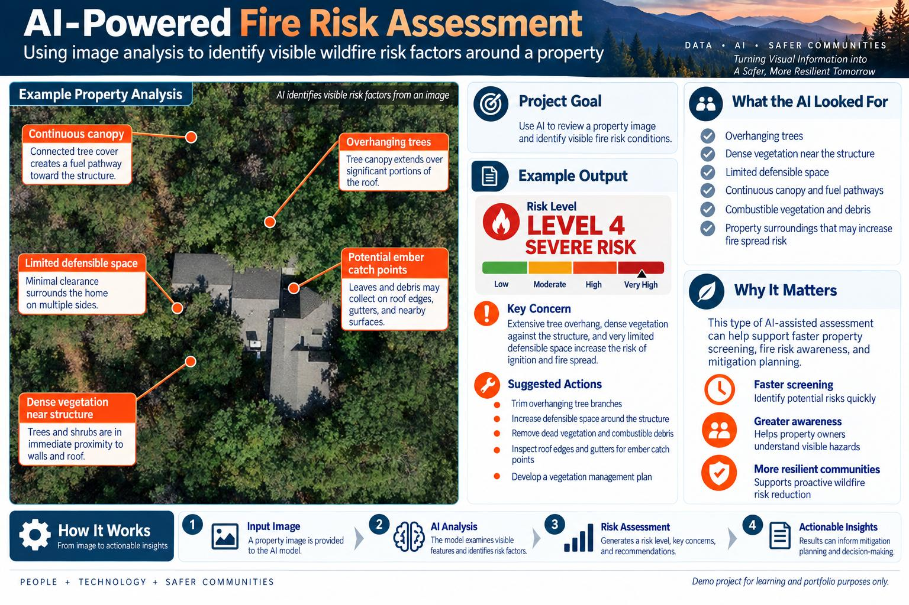

# Multimodal AI Document Analysis

### Python | Jupyter Notebooks | Claude API | Image & PDF Analysis | Source Citations

## Overview

This repository contains a set of Python and Claude API projects focused on multimodal analysis across images and PDF documents.

The projects demonstrate how Claude can work with visual inputs, summarize document content, answer questions from PDFs, and return responses grounded in source citations.

Together, they show how multimodal AI can support more structured analysis of visual and document-based information.

---

## Projects Included

### 1. Image Support – Fire Risk Assessment

**Notebook:** [`Claude_Image_Support_Fire_Risk_Assessment_v1.ipynb`](notebooks/Claude_Image_Support_Fire_Risk_Assessment_v1.ipynb)

Demonstrates image analysis using Claude's multimodal capabilities.

The project uses an image as input and asks Claude to identify visual conditions relevant to fire risk.

#### Fire Risk Assessment: Visual Demonstration



*Illustrative portfolio graphic based on the fire-risk notebook's example image analysis. The demonstration identifies visible tree overhang, dense vegetation, and limited defensible space, with an example Level 4 (Severe Risk) rating. This is an image-based AI screening exercise, not a certified wildfire hazard inspection or a validated property risk determination.*

Key concepts:

- Image input handling
- Multimodal prompting
- Visual interpretation
- Risk-oriented analysis
- Structured observations from visual evidence

This project illustrates how AI can extract useful information from images rather than relying only on text input.

---

### 2. PDF Support – Earth Summary

**Notebook:** [`Claude_PDF_Support_Earth_Summary_V2.ipynb`](notebooks/Claude_PDF_Support_Earth_Summary_V2.ipynb)

Demonstrates direct PDF document analysis with Claude.

The workflow provides a PDF document to the model and requests a concise summary of its contents.

Key concepts:

- PDF input handling
- Document summarization
- Long-form content analysis
- Multimodal document processing
- Source-based response generation

This project shows how AI can analyze document content directly without requiring the document to be manually converted into plain text first.

---

### 3. PDF Question Answering with Citations

**Notebook:** [`Claude_PDF_Support_Earth_Summary_v1.ipynb`](notebooks/Claude_PDF_Support_Earth_Summary_v1.ipynb)

Extends PDF analysis by enabling source citations in Claude's response.

The project demonstrates how the model can answer questions about a document while returning citation information linked to the original PDF.

Key concepts:

- PDF question answering
- Citation-enabled responses
- Source grounding
- Evidence traceability
- Document-based retrieval
- Page-level attribution

The document input includes citation support:

```python
"citations": {"enabled": True}
```

This allows generated answers to remain connected to evidence from the supplied source.

---

## Multimodal Workflow

These projects demonstrate two major forms of multimodal AI input:

```text
                   ┌── Image Input ────── Fire Risk Analysis
User / Application ┤
                   └── PDF Input ──────── Document Analysis
                                             │
                                             ├── Summarization
                                             │
                                             └── Question Answering
                                                      │
                                                      ↓
                                              Source Citations
```

The workflow illustrates how the same language-model interface can be extended beyond plain text to support visual and document-based analysis.

---

## Repository Structure

```text
multimodal-ai-document-analysis/
├── notebooks/
│   ├── Claude_Image_Support_Fire_Risk_Assessment_v1.ipynb
│   ├── Claude_PDF_Support_Earth_Summary_V2.ipynb
│   └── Claude_PDF_Support_Earth_Summary_v1.ipynb
├── visualizations/
│   └── fire_risk_assessment_demo.png
├── .gitignore
└── README.md
```

The Jupyter notebooks retain their original example code and recorded demonstration outputs. The `visualizations/` folder holds the fire-risk portfolio infographic.

---

## Technologies and Concepts

Projects in this repository use or explore:

- Python
- Jupyter Notebook
- Anthropic Claude API
- Multimodal AI
- Image analysis
- PDF analysis
- Document summarization
- Citation grounding
- Source attribution
- Environment-variable credential management

---

## API Key Handling

API credentials are loaded from environment variables rather than stored directly in the notebooks.

Example:

```python
from dotenv import load_dotenv
import os

load_dotenv()

api_key = os.getenv("ANTHROPIC_API_KEY")
```

Local `.env` files containing credentials should never be committed to source control.

---

## Running the Notebooks

Install the notebook environment and supporting Python packages:

```bash
pip install notebook anthropic python-dotenv
jupyter notebook
```

Open a notebook from the `notebooks/` directory. Provide a valid `ANTHROPIC_API_KEY` through your local environment or an untracked `.env` file.

**External demonstration inputs:** The notebooks reference `images/prop7.png` (property image) and `earth.pdf` (PDF source). These input files are not included in the public repository; supply your own example files using the paths expected by the running notebook. Relative paths are resolved from the notebook kernel's working directory.

The original notebooks contain completed example outputs. Re-running the exercises requires access to an available Claude model and compatible API SDK; some example settings may need updating as model availability changes.

---

## Demonstration Scope and Limitations

- The fire-risk example interprets visible property features from an image. It does not validate on-site conditions, unseen hazards, actual fire behavior, or professionally certified risk scores.
- PDF summaries and citation-enabled answers are model-generated and should be checked against the source document.
- The notebooks are instructional demonstrations of multimodal API workflows rather than a deployed property-inspection or document-review application.
- Public repository materials do not include private API credentials or the original input images and PDF.

---

## Why Multimodal AI Matters

Many real-world workflows involve information that does not exist only as structured text.

Relevant information may instead appear in:

- Images
- Reports
- PDF documents
- Forms
- Visual inspections
- Technical documentation
- Research materials

Multimodal AI allows these sources to be analyzed within a shared workflow.

### Image Analysis

Image-based models can identify and interpret visible features that may be relevant to a larger assessment.

In the fire-risk project, the image becomes part of the evidence used to generate observations.

### Document Analysis

PDF support allows the model to reason directly over document content.

This can support tasks such as:

- Summarization
- Information extraction
- Question answering
- Document review
- Research assistance

### Citation Grounding

Citation-enabled responses improve traceability by connecting generated claims back to the supplied document.

This is especially important when AI-generated information needs to be reviewed or verified by a human.

---

## Project Significance

This repository demonstrates practical experience with:

- Sending images to multimodal language models
- Analyzing visual information
- Processing PDF documents through an AI API
- Summarizing document content
- Asking questions about source documents
- Enabling citation-grounded responses
- Connecting AI outputs to supporting evidence
- Designing multimodal analysis workflows

The projects focus on practical experimentation with Claude's native image and document capabilities.

---

## Security and Environment Configuration

Credentials are excluded from the notebooks and should be stored locally using environment variables.

A typical `.env` configuration may include:

```text
ANTHROPIC_API_KEY=your_key_here
```

A `.gitignore` file can also be used to prevent local development files from being committed:

```text
.env
.venv/
__pycache__/
.ipynb_checkpoints/
```

---

## Future Expansion

Potential extensions include:

- Multi-document analysis
- Image comparison workflows
- Structured extraction from PDFs
- Automated report generation
- Document classification
- Citation-grounded research workflows
- Larger multimodal datasets
- Human-in-the-loop review
- Evaluation of multimodal model outputs
- Integration with retrieval systems

---

## Status

**Current status: Complete multimodal analysis project collection**

This repository contains three projects demonstrating image understanding, PDF summarization, and citation-grounded document analysis.

These projects provide a foundation for more advanced workflows involving evidence-based AI, research assistance, document intelligence, and multimodal decision support.

---

**Project Type:** Applied AI & Multimodal Document Analysis Portfolio Project  
**Technologies:** Python, Jupyter Notebook, Anthropic Claude API, Anthropic Python SDK, python-dotenv  
**Core Methods:** Multimodal Prompting, Image Interpretation, PDF Summarization, Citation-Grounded Question Answering  
**Data Classification:** Demonstration Inputs / Illustrative Portfolio Visualization  
**Project Status:** Completed Multimodal Analysis Notebook Collection  
**Repository Scope:** Three Jupyter Notebooks, Recorded Example Outputs, and Portfolio Visualization  

**Developed by Glahnnia "Renee" Rates, MSHS, CCHW II**  
Public Health Informatics | Applied AI | Workforce Development | Data Analytics
